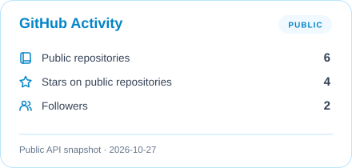
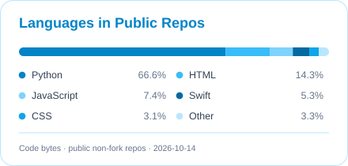

# AllenCC

I'm exploring embodied intelligence.
My current open-source work focuses on speech tools and evaluation.

## Selected projects

### [CosyVoice-WebSocket](https://github.com/Allencc5658/CosyVoice-WebSocket)

Real-time streaming text-to-speech with CosyVoice over WebSocket.
Includes a Python client and a browser test page.

### [VoiceRecognizor](https://github.com/Allencc5658/VoiceRecognizor)

Text-to-speech quality evaluation with Paraformer speech recognition.
Supports batch evaluation, text comparison, and CER/WER visualization.

GitHub activity and languages

<picture>
  <source media="(prefers-color-scheme: dark)" srcset="./profile/stats-dark.svg">
  
</picture>
<picture>
  <source media="(prefers-color-scheme: dark)" srcset="./profile/languages-dark.svg">
  
</picture>

Language proportions reflect public code bytes, not proficiency.

Contribution snake

<picture>
  <source media="(prefers-color-scheme: dark)" srcset="./profile/snake-dark.svg">
  
</picture>

